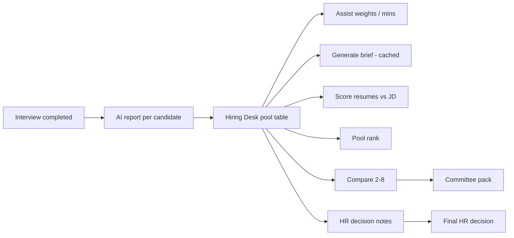

# Hiring Desk — HR walkthrough & presentation guide

Use this as a **script, slide outline, and demo checklist** for introducing the Hiring Desk preview to HR. Target length: **25–35 minutes** (+ 10 min Q&A).

## One-line pitch

> **Hiring Desk is a single screen per job where HR sees the whole interview pool, tunes what “good” means for that role, uses AI to compare candidates — and still makes every final call. It does not auto-hire or replace Leaderboard, Candidates, or legacy Compare.**

## What problem it solves

| Today (scattered) | Hiring Desk |
|-------------------|-------------|
| Open reports one by one | Pool table + cohort stats |
| Hard to compare 5+ people | Compare heatmap (2–8) + AI brief |
| Resume vs role = gut feel | **Resume vs JD** grades (A/B/C) |
| Committee prep = copy-paste | **Committee pack** (HTML download) |
| No audit trail for disagreeing with AI | **Decision notes** log |

## Framing (say this early)

- **Preview / beta** — separate from Leaderboard, Candidates, and legacy Compare; existing screens unchanged.
- **Decision support, not auto-hire** — Assist score, AI shortlist, and pool rank are **proposals**.
- **Interview AI scores are read-only** — weights and minimums affect the **Assist** column only.
- **Who can run AI actions** — job creator or admin roles (Owner / HR Head). Portal members can **view** the desk.

**Enable:** `HIRING_DESK_BETA=true` in environment or `app_settings.hiring_desk_beta`. Requires migrations **016–017** (see `docs/HIRING_DESK_BETA.md`).

**Navigation:** Sidebar → **Hiring desk (preview)** → **Open desk** on a role.

## Suggested agenda (30 min)

| Min | Topic |
|-----|--------|
| 3 | Why we built it + what it does *not* do |
| 2 | Job picker (applicants vs AI reports) |
| 5 | Pool table + cohort stats |
| 5 | Scoring bar & weights → **Assist** |
| 6 | AI brief, resume vs JD, pool rank |
| 4 | Compare + committee pack |
| 3 | Decision notes + links to standard tools |
| 2 | Costs, caching, when to regenerate |
| 5+ | Q&A |

## Live walkthrough (top → bottom)

### A — Landing (`/hiring-desk`)

Pick the role you are closing. Columns: job title, department, status, **Applicants**, **AI reports**.

**Demo tip:** Use a job with **≥ 2** reports (brief) and **≥ 3** (pool rank).

### B — Job desk header + stats

- Reports in pool, average overall, score range, middle 50% (quartiles).
- Subtitle: Assist uses **latest interview report** per candidate only.

### C — AI hiring brief

1. **Generate / Regenerate brief** — needs ≥ 2 AI reports; one cached Azure call. Outputs cohort summary, suggested shortlist (for review), head-to-head, committee questions, coverage gaps, risks. Regenerate if JD/reports/rubric changed (stale banner).
2. **Score resumes vs JD** — uploaded CV vs job fields; fills **Resume vs JD** (A/B/C). Not from interview audio. Skips missing resumes.
3. **Committee pack (HTML)** — download for committee meetings.

### D — Scoring bar & weights

Minimums (0–10) per dimension → candidates below bar show **!** on Assist. Weight % for overall, experience, culture, soft skills (+ optional rubric criterion weights). **Save scoring setup** recalculates Assist and pool rank column.

### E — AI pool ranking

**Generate pool rank** — needs ≥ 3 reports; listwise AI (batches of 6). Use with compare + brief for large pools.

### F — Filters + pool table

Filters: decision status, **Has AI report only**.

| Column | Meaning |
|--------|---------|
| Pool rank | Assist composite, else overall |
| Assist | Weighted score; ! if below minimums |
| Resume vs JD | After resume scoring |
| Overall / Experience / Culture / Soft skills | Latest AI report |
| Report | Opens standard full report page |

Select **2–8** candidates with reports → **Compare selected (preview)**.

### G — Compare view

Heatmap by score, rubric rows, stage/decision, summary snippets with links to full reports.

### H — HR decision notes

Log agree/disagree with AI shortlist or general notes with required reason — audit trail with timestamp and user.

### I — Rest of the product

Footer links: Job interviews, Leaderboard, Candidates — desk does not replace them.

## Slide outline (10–12 slides)

1. Title — Hiring Desk preview for HR  
2. Problem — fragmented post-interview review  
3. Principles — human decision, no auto-hire, isolated preview  
4. Flow — Interviews → AI reports → Desk reads → optional on-demand AI  
5. Job list screenshot  
6. Pool table + stats  
7. Three AI actions (brief / resume / pool rank)  
8. Assist weights & minimum bar  
9. Compare heatmap  
10. Committee pack + decision notes  
11. Permissions & beta flag  
12. Feedback ask  

## FAQ

| Question | Answer |
|----------|--------|
| Replace HRIS / offers? | No — review and committee prep only. |
| Change interview scores? | No. Weights change Assist only. |
| Brief button disabled? | Fewer than 2 reports on that job. |
| Empty Resume vs JD? | No resume file or scoring not run. |
| Stale brief? | Regenerate after JD/report/rubric changes. |
| Who runs paid AI buttons? | Job creator + admins. |
| Shortlist = hire list? | Suggested for review; log overrides in decision notes. |
| vs Leaderboard? | Leaderboard unchanged; desk is richer per-job support. |

## Demo checklist

- [ ] Hiring desk beta enabled on demo environment  
- [ ] One job with 4–6 candidates, **3+ completed AI reports**  
- [ ] Resumes uploaded for at least 2 candidates  
- [ ] Job description fields filled for resume scoring  
- [ ] Login as job creator or HR Head  
- [ ] Pre-run brief + resume scoring once for a smooth live demo  
- [ ] Hard refresh browser after front-end deploy  

## Closing feedback questions

1. Is **Assist + minimum bar** clear?  
2. **Resume vs JD** vs **interview scores** — distinct enough?  
3. Would you use **Committee pack** in real committees?  
4. What is missing (CTC, notice period, bulk stage actions)?  
5. Pilot on how many roles for how many weeks before merging into main nav?

## Related docs

- `docs/HIRING_DESK_BETA.md` — routes, enable flag, integration policy  
- `docs/PAID_API_SERVICES.md` — Azure OpenAI cost for desk buttons  
